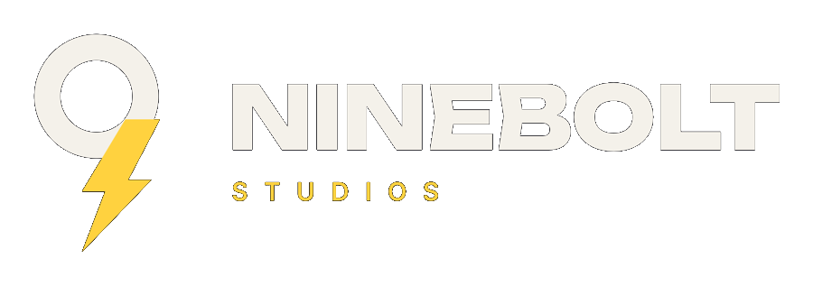
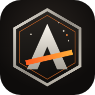
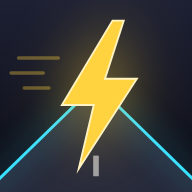

<h3 align="center">Games with a jolt ⚡</h3>

Free games you can play right in your browser, on iPhone, iPad, Android and PC.

<b>🌐 <a href="https://ninebolt-studios.github.io/Ninebolt-Studios-Website/">ninebolt-studios.github.io/Ninebolt-Studios-Website</a></b>

## 🎮 Our games

| | Game | Play | Code |
|---|---|---|---|
|  | **Ashfall**: tactical arena shooter. 5v5 online, Duels, co-op Zombies, Battle Royale-lite, Prop Hunt, weekly seasons | [▶ Play](https://ninebolt-studios.github.io/Ashfall/) | [Repo](https://github.com/Ninebolt-Studios/Ashfall) |
|  | **Boltrush**: arcade racer. 7 adaptive rivals, drift combos, ⚡ items, ramps, tutorial | [▶ Play](https://ninebolt-studios.github.io/Boltrush/) | [Repo](https://github.com/Ninebolt-Studios/Boltrush) |

One ☁️ account works in every Ninebolt game.

## 🛠️ About this repo
This is the studio website: a single `index.html` with its images, hosted free on GitHub Pages (Settings → Pages → main / root).
